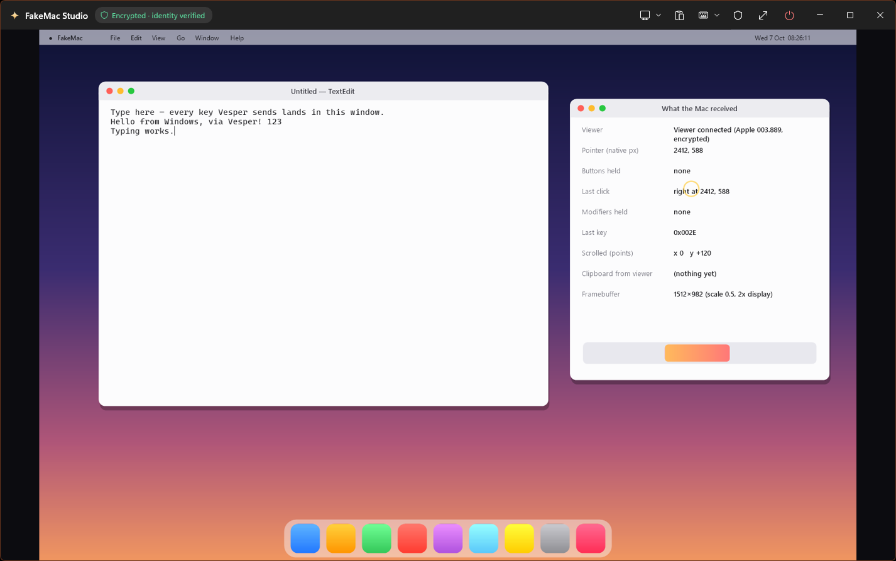
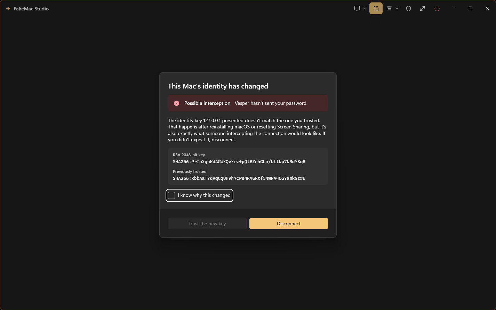
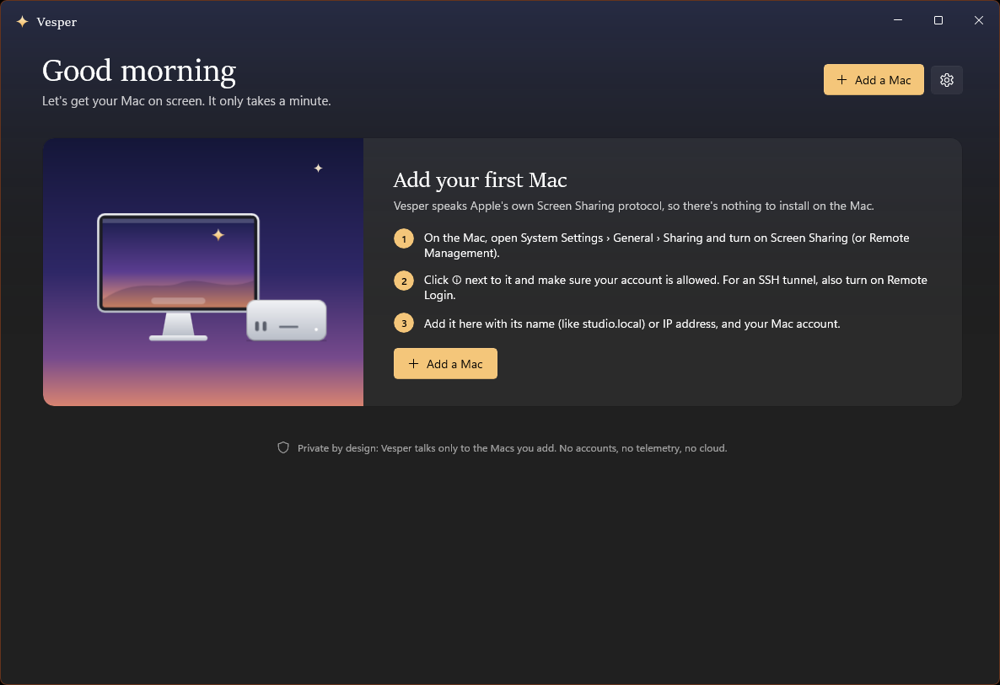
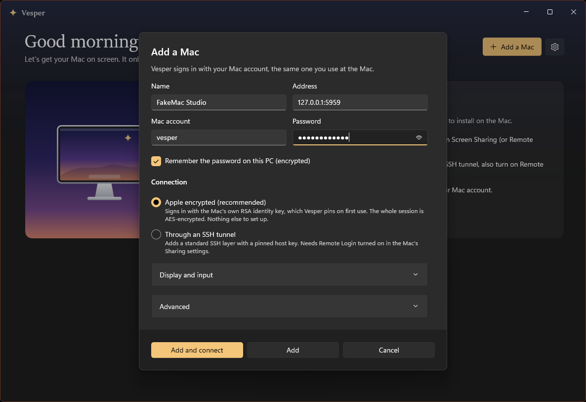
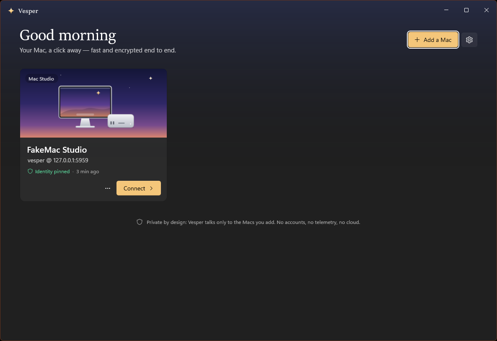
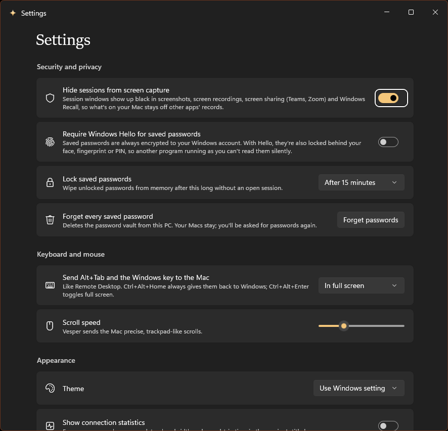

# Vesper

**A fast, secure Apple Remote Desktop client for Windows and Arch Linux.** Built for one job:
putting your Mac's screen on your PC as if you were sitting at it, without the lag of plain VNC
and without leaking a thing.

Vesper speaks Apple's own Screen Sharing protocol (RFB 003.889), not generic VNC. There's
nothing to install on the Mac. No accounts, no telemetry, no cloud: it talks only to the Macs you
add, and to GitHub to keep itself up to date (with signed updates you can turn off).

**Download:** [Totaie/Vesper-releases](https://github.com/Totaie/Vesper-releases/releases/latest)
(Windows Setup or portable zip, x64 and ARM64; Arch Linux package).



> Screenshots show FakeMac, Vesper's built-in stand-in for a Mac (see [Testing](#testing-without-a-mac)).

---

## Why it's fast where VNC lags

A Mac answers plain VNC clients the slow way. Vesper uses the parts of Apple's protocol that
Apple's own viewer (and Remote Desktop Manager's ARD mode) use:

| | Plain VNC | Vesper |
|---|---|---|
| Screen updates | Polled; a Mac answers incremental requests late (2–9 updates/s while scrolling) | **Pushed** by the Mac as the screen changes (`AutoFrameBufferUpdate`), paced so input never queues behind pictures |
| The picture | Raw pixels through zlib: megabytes per frame, which is what makes macOS VNC crawl on a Retina screen | Apple's **adaptive codec** (MVS), as Apple's viewer and Remote Desktop Manager use: JPEG-like 8×8 tiles, copies and a tile cache, arriving coarse and sharpening in a moment. A full 2560×1440 frame is a few hundred KB, decoded on every core |
| Retina displays | Every native pixel: a 5K Studio Display is 14.7 million pixels per frame | The Mac **scales on its side** to fit your monitor's pixels: a 5K screen shown on a 1080p monitor arrives as 1920×1080, and full screen is exactly one pixel per pixel, so nothing is resampled |
| Mouse pointer | Drawn into the picture, so it moves at the network's pace | The Mac sends its pointer images; Vesper makes them **real Windows hardware cursors** that move at your mouse's own rate |
| Scrolling | Wheel "clicks" the Mac turns into ~2 px nudges | Apple's **precise scroll** message: smooth, trackpad-like, both axes |
| Drawing | CPU blits | GPU (Win2D/Direct2D) on its own thread; only changed rectangles are uploaded; composed by Windows like any window, so variable-refresh monitors don't flicker |
| Network | Nagle on | TCP_NODELAY, coalesced pointer moves, large receive buffers |

## Security

Your Mac's screen, keystrokes and password are the most sensitive things on your network.
Vesper's defaults assume a hostile network and an untrusted PC environment. See
[SECURITY.md](SECURITY.md) for the full threat model.

- **Encrypted end to end, always.** Every session with a Mac runs inside Apple's AES record layer,
  for the whole picture and every keystroke. Vesper always turns it on, while Apple's viewer
  leaves it off by default. A server that won't encrypt is refused before anything is sent
  (other VNC servers work only inside the SSH tunnel).
- **The Mac proves who it is.** Vesper signs in with the Mac's RSA identity key (Apple's
  security type 33) and **pins it on first use**, like SSH, but only once the Mac has proven it
  holds the private key, so replaying a Mac's public key gets an impersonator nowhere. If the
  key ever changes, Vesper stops *before your password is sent* and says why.
- **Optional SSH tunnel** through the Mac's Remote Login, with a pinned host key. It's a
  direct-tcpip channel handed straight to the session, so no local port is opened and no other
  program on your PC can use the tunnel.
- **No downgrades.** Apple's older Diffie-Hellman sign-in can't prove the Mac's identity, so
  it's only used where something else does: inside the SSH tunnel, or straight to the Mac's own
  Tailscale address (not through a subnet router, exit node or other VPN). Otherwise it needs
  your explicit permission for that Mac, and even then never for a Mac that has proven its
  identity key before.
- **Passwords** are sealed with AES-256-GCM under a key protected by Windows (DPAPI) or, on
  Linux, held in your login keyring, and on Windows optionally **locked behind Windows Hello**, so another program running as you can't read them
  without a visible prompt. Each one is sealed together with where it may go, so a Mac's
  settings edited behind Vesper's back don't get the saved password. Unlocked passwords are
  wiped from memory after 15 idle minutes.
- **Hidden from screen capture by default.** Session windows show up black to screenshots,
  screen recording, Teams or Zoom screen sharing, and **Windows Recall**.
- **Clipboard sharing is off** unless you turn it on for a Mac. Even then it only works while
  the session window is in front, copies your password manager marks private stay on Windows,
  and text from the Mac is kept **out of Windows clipboard history and cloud clipboard sync**.
- **No leaks from the app itself.** Nothing is logged to disk, and Windows Error Reporting is
  disabled for the process, since a crash dump would hold screen contents and session keys.
  Legacy DLL injection points (AppInit DLLs, global hook DLLs, Winsock LSPs) and DLLs from the
  current directory or network shares are refused.
- **Signed updates.** Vesper installs only updates signed with its release key (ECDSA P-256),
  newer than what's running, and matching their signed SHA-256. Someone who took over the
  releases page, or the network, couldn't push anything else.
- **Built defensively.** Every length and rectangle from the Mac is bounds-checked before it's
  used. Decompression is capped (no zip bombs). Unknown messages end the session rather than
  being guessed at. Pinned NuGet packages are verified against lock files, and known-vulnerable
  packages fail the build.



## Setting up the Mac

1. On the Mac: **System Settings › General › Sharing**, turn on **Screen Sharing** (or
   **Remote Management**).
2. Click **ⓘ** next to it and make sure your account is allowed. With Remote Management,
   "All users" isn't enough: add your account and allow **Observe** and **Control**.
3. *(Optional, for the SSH tunnel)* turn on **Remote Login** too.
4. In Vesper: **Add a Mac** with its name (`studio.local`) or IP address and your Mac account.

The first time you connect, Vesper shows the Mac's identity fingerprint and asks you to trust
it. From then on it's silent unless the key changes.

| | |
|---|---|
|  |  |
|  |  |

## Using it

- **Ctrl is ⌘ Command** by default (switchable per Mac): Ctrl+C, Ctrl+V, Ctrl+Tab and Ctrl+Q
  do on the Mac what they do on Windows. Alt is ⌥ Option, and the Windows key is ⌃ Control.
- **Full screen** with the toolbar button or **Ctrl+Alt+Enter**. In full screen, Alt+Tab and the
  Windows key go to the Mac, like Remote Desktop. **Ctrl+Alt+Home** always hands them back to
  Windows.
- The **keyboard menu** sends Spotlight, Mission Control, Force Quit, Screenshot and Lock Screen.
- The **display menu** switches between fitting the window and 1:1 pixels, between scaled and
  native resolution, between Adaptive (Apple's fast codec, the default), lossless full colour,
  thousands of colours and greyscale, and between the Mac's displays. With connection stats on
  (Settings), the session shows its frame rate, bandwidth, latency and the codec in use.

## Installing

Releases are published to the public [Totaie/Vesper-releases](https://github.com/Totaie/Vesper-releases)
repository, which installed copies also update from.

- **Windows Setup** (`Vesper-x.y.z-Setup-x64.exe`, or `-arm64` for Snapdragon/ARM PCs) installs
  for you only, with no administrator prompt, into `%LOCALAPPDATA%\Programs\Vesper`, with a
  Start menu entry and an uninstaller in Settings › Apps.
- **Portable** (`Vesper-x.y.z-win-x64.zip`): extract the folder anywhere and run the `Vesper.exe`
  at its top (the `app` folder beside it holds the program).
- **Arch Linux** (`vesper-x.y.z-1-x86_64.pkg.tar.zst`): `sudo pacman -U` it. Add `libsecret` and
  a keyring (`gnome-keyring`, or KWallet) to save passwords, and `polkit` for in-app updates.

No .NET or Windows App SDK needs installing. The Windows builds aren't code-signed, so the first
launch may show "Windows protected your PC": choose **More info › Run anyway**. Macs and
settings are kept in `%LOCALAPPDATA%\Vesper` (Linux: `~/.config/vesper`).

## Updates

Vesper checks its releases a little after starting and twice a day, downloads a new version in
the background, and installs it when you restart or quit it: the next Setup runs silently, a
portable copy swaps in a new `app` folder, and on Arch `pacman` installs the package after your
password. Each release's `vesper-update.json` lists every download's size and SHA-256 and is
signed with Vesper's release key; Vesper checks that signature, that the version is newer, and
each download's hash before using it. Turn it off in Settings › Updates.

## Building

Requirements: .NET SDK 10.0.1xx (see `global.json`). For the Windows app: Windows 10 2004+ and
Visual Studio 2022 17.14 or newer (only for its MSBuild components; `dotnet build` works too);
for the downloads, Visual Studio's C++ build tools (the portable launcher) and Inno Setup 6.

```powershell
dotnet build Vesper.slnx -p:Platform=x64
dotnet test tests\Vesper.Core.Tests
dotnet run --project src\Vesper.Linux    # the Linux app also runs on Windows, for development
.\scripts\publish.ps1            # self-contained Release build in .\publish\win-x64
.\scripts\package.ps1            # Setup and portable zip for x64 and ARM64 in .\dist
```

The Arch package is built by `.github/workflows/linux.yml` in an Arch Linux container
(`packaging/arch/build.sh`), which also runs the tests there and installs and starts the
package. To release: put its package in `.\dist` beside the Windows downloads and run
`.\scripts\release.ps1 -Summary "..."`, which signs the update description with the release
key (kept only on the release machine, under `%USERPROFILE%\.vesper-release`; back it up with
`dotnet run --project tools\Vesper.ReleaseTool -- backup <file>`) and publishes to
Totaie/Vesper-releases.

## Testing without a Mac

`tools/Vesper.FakeMac` is a loopback-only stand-in for macOS Screen Sharing. It has Apple's
handshake, RSA and Diffie-Hellman sign-in, the encrypted record layer, display layout, the
cursor cache, pushed updates and the pasteboard. It draws a desktop that shows every key,
click, scroll and clipboard change it receives. It can also misbehave on purpose: speak plain
VNC (`--rfb38`), refuse RSA logins (`--reject-rsa`), or impersonate a Mac by replaying its
public key without the private key (`--impersonate`).

```powershell
dotnet run --project tools\Vesper.FakeMac -- --animate --ssh-port 2222
# then add a Mac in Vesper: 127.0.0.1, port 5959, account "vesper", password "evening-star"
```

The test suite runs Vesper's session against it over real sockets, including through the SSH
tunnel, and checks the Diffie-Hellman maths against noVNC's published test vector.

## How it's built

```
src/Vesper.Core     the protocol: handshake, sign-in, record layer, decoders, SSH transport
src/Vesper.Client   shared by both apps: saved Macs, the vault, connecting, signed updates
src/Vesper.App      the Windows app (WinUI 3): windows, GPU renderer, input, clipboard
src/Vesper.Linux    the Linux app (Avalonia): the same, for X11 and Wayland desktops
installer/          the Windows Setup script (Inno Setup)
packaging/          the Arch Linux package
tests/              unit and end-to-end tests (against FakeMac)
tools/Vesper.FakeMac
docs/PROTOCOL.md    Apple's protocol as Vesper implements it, with sources
```

## Credits

Apple doesn't document RFB 003.889. Vesper's implementation rests on others' careful
reverse engineering, especially **remotex** (MIT, measurements of macOS 26), **ard-rs** (MIT,
whose adaptive-codec decoder Vesper ports; see [THIRD-PARTY-NOTICES.md](THIRD-PARTY-NOTICES.md)), **noVNC** and its
**noVNC-ARD** fork, and **libvncclient**. See [docs/PROTOCOL.md](docs/PROTOCOL.md).

## The name

Vesper is the evening star: Hesperus to the Greeks. The Hesperides, "nymphs of the evening",
guarded the golden apples in a garden at the western edge of the world, beside Atlas. A
guarded way into your Apple.
